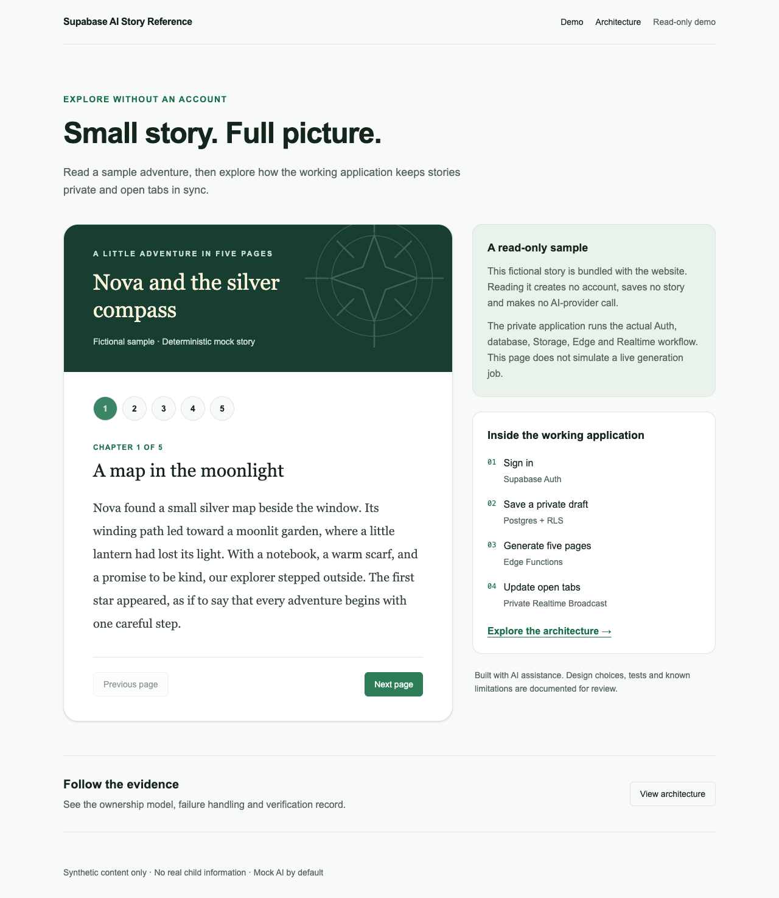
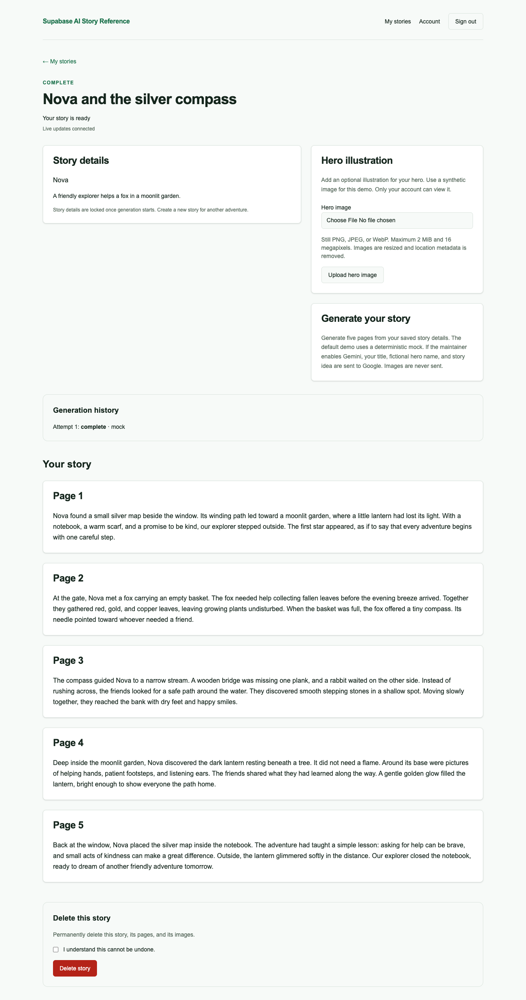

# Supabase AI Story Reference

[](https://github.com/nshaikh3/supabase-ai-story-reference/actions/workflows/ci.yml)

A multi-tenant Next.js app on Supabase where each account's stories, images, AI generation jobs and live updates stay private. Postgres row-level security enforces it, not the UI, and the tests prove it.

**[Live demo](https://supabase-ai-story-reference.vercel.app/demo)** · **[Architecture tour](https://supabase-ai-story-reference.vercel.app/architecture)** · **[Reviewer guide (10–15 min)](docs/REVIEWER-GUIDE.md)** · **[Case study](docs/CASE-STUDY.md)**

[](https://supabase-ai-story-reference.vercel.app/demo)

The public site is a read-only sample that needs no account. The full application (sign-up, private stories and images, generation and live updates) runs locally and in CI; see [what this is not](#what-this-is-not).

## What it demonstrates

| Supabase feature | How it is used | Where to look |
| --- | --- | --- |
| Auth | Email confirmation, PKCE callback and SSR cookie sessions, re-verified at every data boundary | [Server client](src/lib/supabase/server.ts), [Auth browser tests](tests/e2e/auth.spec.mts) |
| Postgres + RLS | One immutable owner per story; pages, images and jobs inherit access from it. Column grants stop owners forging status or ownership | [Owner migration](supabase/migrations/20260928202944_add_owner_authorization.sql), [role-based pgTAP tests](supabase/tests/database/authorization.test.sql) |
| Storage | Private bucket and owner-scoped paths; images are re-encoded and served through an authenticated, uncached route | [Storage policies](supabase/migrations/20260929041425_add_private_story_storage.sql), [image route](src/app/assets/[id]/route.ts) |
| Edge Functions | Generation runs with the caller's JWT plus a narrow worker capability, never a service-role key. One active job per story, leases and atomic five-page completion | [Edge handler](supabase/functions/generate-story/handler.ts), [lifecycle migration](supabase/migrations/20260929231039_add_generation_lifecycle.sql) |
| Realtime | Private Broadcast topic per story. Messages are invalidation hints; each tab refetches what it is allowed to see. Reconnect catch-up, no polling | [Receive policy](supabase/migrations/20260930142245_add_private_generation_broadcast.sql), [client lifecycle](src/lib/stories/realtime.ts) |

<details>
<summary>Screenshot of the authenticated workspace (local app, mock generation)</summary>



</details>

## Three decisions worth discussing

1. **The database decides ownership.** Only `stories` has an owner column. Children derive access through their parent, so there is no second ownership field to drift. RLS covers rows; column-level grants cover fields like `status` and `owner_id`. Both are tested with real API roles, including direct Data API calls that bypass the UI. ([ADR-003](docs/DECISIONS.md#adr-003-parent-derived-ownership), [ADR-010](docs/DECISIONS.md#adr-010-owner-policies-plus-column-privileges))
2. **No service-role key in the app.** The Edge Function runs as the caller. The few transitions a user must not perform directly (claiming a job, publishing pages) require both the owner's identity and a worker secret that only the function holds. ([ADR-014](docs/DECISIONS.md#adr-014-caller-authorization-plus-a-narrow-worker-capability))
3. **Realtime says something changed; the database says what.** Broadcast messages carry IDs and a status, never content. Tabs refetch through RLS after every message and every reconnect, so a lost or out-of-order message cannot show stale or unauthorized data. ([ADR-017](docs/DECISIONS.md#adr-017-private-status-notifications-with-authoritative-reconciliation))

## Evidence

[CI](https://github.com/nshaikh3/supabase-ai-story-reference/actions/workflows/ci.yml) runs on pushes and pull requests on a fresh Linux runner: clean install, production dependency audit, a local Supabase stack, then:

- **356 pgTAP assertions** across schema, constraints, RLS and grants, Storage, generation, Realtime and quotas
- **308 unit tests**, TypeScript, lint and a production build
- **8 browser scenarios**: sign-up through password recovery, Edge generation, two-tab Realtime with offline catch-up and cross-tab sign-out, CSP nonces, private image access and cross-account denial
- **11 RLS query plans** measured as the `authenticated` role over 10,000 synthetic stories ([results](docs/PERFORMANCE.md))

Also in the repository: the [security model](docs/SECURITY.md), an [agent-run security audit](docs/SECURITY-AUDIT.md) with its open findings, [22 decision records](docs/DECISIONS.md) and [Supabase friction notes](docs/CONTRIBUTION-NOTES.md) collected while building.

## What this is not

- **Not a hosted product.** The account-based app runs locally and in CI. Hosting it publicly would need abuse and spending controls, production SMTP and a hosted verification pass, which I chose not to take on for a reference project. The [deployment plan](docs/DEPLOYMENT.md) lists those gates.
- **Not live AI by default.** Generation uses a deterministic mock so it is free and reproducible. An optional Gemini adapter exists but has not been validated against the live API.
- **Not a durable queue.** Generation is a bounded request with manual lease recovery, and Broadcast is best-effort. Storage and database cleanup are eventually consistent, with reviewed reconciliation tooling.
- **Not independently audited.** The security audit was run by the coding agent with automated evidence; no human penetration test has been done.

## How it was built

I directed the build with an AI coding agent (Codex) through seven phases, each with explicit acceptance checks: foundation, Auth, Storage, generation, Realtime, security and performance review, and deployment preparation. I set the scope and constraints, approved each phase and made the product and release decisions. The [AI-assisted development record](docs/AI-DEVELOPMENT.md) describes the division of work. The [execution record](docs/record/README.md) keeps each phase's dated results, including the failures. Nine generic UI and configuration files came from an existing app of mine, with source hashes in the [reuse manifest](docs/REUSE-MANIFEST.json).

## Run it locally

Needs Node 24, Docker and free ports 3100, 55320–55324 and 55328. No Supabase account or AI key is required.

```bash
npm ci
npm run local:check
npm run supabase:start:core
npm run local:env
npm run db:reset
npm run db:types
npm run dev
```

Open http://127.0.0.1:3100 and sign up; confirmation emails arrive in the local inbox at http://127.0.0.1:55324. [Local development](docs/LOCAL-DEVELOPMENT.md) covers verification commands, the browser suite, generation settings and the read-only showcase build.

## Documentation

| Document | Contents |
| --- | --- |
| [Architecture](docs/ARCHITECTURE.md) | Trust boundaries, request flows, generation and Realtime sequences |
| [Database](docs/DATABASE.md) | Schema, policies and migration inventory |
| [Security model](docs/SECURITY.md) · [audit](docs/SECURITY-AUDIT.md) | Threat model, boundaries, findings and their status |
| [Decisions](docs/DECISIONS.md) | 22 architecture decision records |
| [Performance](docs/PERFORMANCE.md) | RLS query plans under the authenticated role |
| [Operations](docs/OPERATIONS.md) · [deployment](docs/DEPLOYMENT.md) | Quotas, cleanup and worker rotation; hosted release gates |
| [Showcase](docs/SHOWCASE.md) | How the static public demo is built and verified |
| [Execution record](docs/record/README.md) | Dated phase results, hardening and publication evidence |

Built by Noor Shaikh · [MIT license](LICENSE) · [Third-party notices](THIRD_PARTY_NOTICES.md)
