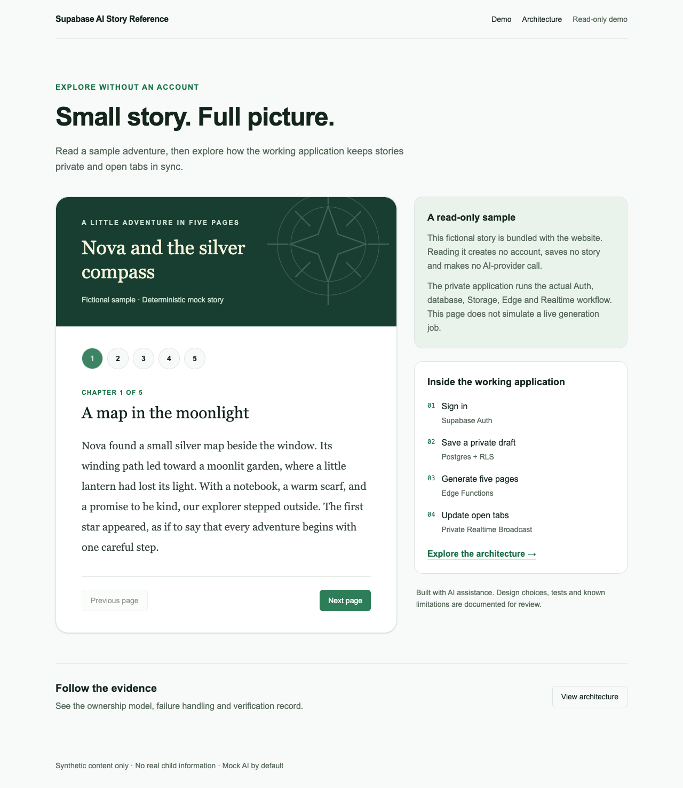
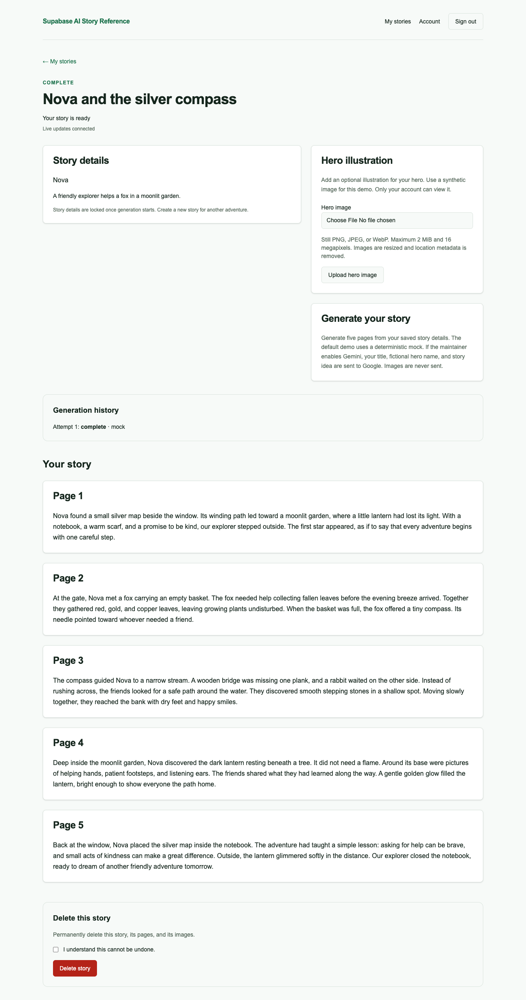

# Supabase AI Story Reference

[](https://github.com/nshaikh3/supabase-ai-story-reference/actions/workflows/ci.yml)

A small multi-tenant story application demonstrating Supabase Auth, Postgres/RLS, private Storage, authenticated Edge generation and private Realtime Broadcast with Next.js.

**Live demo:** [read the sample](https://supabase-ai-story-reference.vercel.app/demo) · [architecture tour](https://supabase-ai-story-reference.vercel.app/architecture). The public site is a read-only showcase; [run the complete application locally](#local-setup). **Source:** [public GitHub repository](https://github.com/nshaikh3/supabase-ai-story-reference), licensed under [MIT](LICENSE).

[Reviewer tour](docs/REVIEWER-GUIDE.md) · [Architecture](docs/ARCHITECTURE.md) · [Security model](docs/SECURITY.md) · [Database](docs/DATABASE.md) · [Deployment preparation](docs/DEPLOYMENT.md) · [Current status](docs/LOCAL-HARDENING.md) · [Original plan review](docs/PLAN-REVIEW.md)

[Case study](docs/CASE-STUDY.md) · [Publication progress](docs/PUBLICATION.md) · [Third-party notices](THIRD_PARTY_NOTICES.md)



The bundled sample is read-only: no account, stored story or AI request is created. The private application below demonstrates the actual service workflow.



*Actual local browser-test capture using fictional text and the deterministic mock provider. No customer content, credentials or commercial assets.*

## Why this exists

This reference makes Noor Shaikh's hands-on software/product work inspectable alongside his consulting and technical program background. The emphasis is on decisions, ownership boundaries, failure handling and reproducible evidence. It is deliberately smaller than a commercial story product and is not a copy of its proprietary features.

## Current scope

Phases 1–5 provide an isolated local database, migrations, synthetic fixtures, generated types, automated tests, email/password authentication and private live story updates. Selected generic components and tooling were reused from an existing application with the owner's authorization; see the [reuse manifest](docs/REUSE-MANIFEST.json).

Sign-up, email confirmation, sign-in/out, password recovery and a protected account page are implemented. The owner dashboard, story editor, deletion and private hero-image uploads are implemented. Protected generation jobs run through an authenticated Edge Function with mock generation and optional Gemini. Private Realtime Broadcast updates open story tabs and reconciles missed events after reconnecting; see the phase record for verification status. The public static demo is deployed; these authenticated capabilities run locally.

Phase 6 adds security regression coverage and a repeatable authenticated query-plan review. See the [audit findings](docs/SECURITY-AUDIT.md) and [performance evidence](docs/PERFORMANCE.md). The runtime patch and local safeguards have since been implemented; an unpatched development dependency advisory and external deployment controls remain open. Passing local tests is not production approval.

Phase 7 supplies the reviewer walkthrough, architecture/security handoff and a staged deployment runbook. The later local hardening implements guarded hosted configuration and a separate staging harness; full-application hosted targets remain unconfigured and their checks remain unexecuted. The runbook does not authorize publication. See [Phase 7's execution record](docs/PHASE-7.md) and the [hardening record](docs/LOCAL-HARDENING.md) for their actual checks.

The [original-plan review](docs/PLAN-REVIEW.md) identified a missing no-account demo, which is now implemented alongside the architecture tour and landing links. The source is published on GitHub. Both GitHub CI jobs passed on October 9. The read-only showcase passed anonymous HTTPS/browser acceptance on October 11. Full-app cloud hosting remains deferred by choice; human review and a narrated walkthrough remain outstanding.

| Capability | Inspectable implementation / evidence |
| --- | --- |
| Auth and sessions | [SSR client](src/lib/supabase/server.ts), fixed PKCE callback, recovery and [browser flows](tests/e2e/auth.spec.mts) |
| Postgres and tenancy | [Versioned migrations](supabase/migrations), explicit column grants, parent-derived RLS and [actual-role tests](supabase/tests/database/authorization.test.sql) |
| Private images | [Storage policies](supabase/migrations/20260929041425_add_private_story_storage.sql), bounded decoding and [authenticated byte route](src/app/assets/[id]/route.ts) |
| Controlled generation | [Edge handler](supabase/functions/generate-story/handler.ts), caller JWT plus worker capability, leases and atomic five-page completion |
| Live progress | [Private receive policy](supabase/migrations/20260930142245_add_private_generation_broadcast.sql), [reconnect/session lifecycle](src/lib/stories/realtime.ts), no interval polling |
| Engineering evidence | [Security audit](docs/SECURITY-AUDIT.md), [query plans](docs/PERFORMANCE.md), [decisions](docs/DECISIONS.md), [AI/reuse provenance](docs/AI-DEVELOPMENT.md) |

## Requirements

- Node.js 24 and npm.
- A running local Docker-compatible daemon, with capacity for an additional Supabase stack.
- Ports 3100, 55320–55324 and 55328 available.

The Supabase CLI is pinned in the development dependencies. A hosted Supabase account or paid AI key is not required for the default mock workflow.

## Local setup

```bash
npm ci
npm run local:check
npm run supabase:start:core
npm run local:env
npm run db:reset
npm run db:types
npm run dev
```

Open http://127.0.0.1:3100. Local mail is http://127.0.0.1:55324. Studio is http://127.0.0.1:55323 when using full mode (`npm run supabase:start`). `local:env` writes only the local public URL, publishable key and application URL to ignored `.env.local`. It never writes privileged keys and refuses to overwrite a differing file. Use `127.0.0.1` consistently so Auth cookies and redirects match.

`db:reset` destroys and recreates **this reference project's local database**, including its seed data. It is intended for disposable development fixtures. The wrapper rejects linked projects and remote arguments. The seed identities are database fixtures, not working login accounts.

Core mode includes eight services: database, API gateway, Auth, Data API, local mail, Storage, Edge Runtime and Realtime. Image transformation, analytics and pooling remain off. Full mode additionally keeps Studio and metadata services for MCP. The stack uses a dedicated network with loopback host bindings, and does not stop another stack to free ports.

A small project-scoped Docker adapter makes those bindings explicit and accommodates Studio's cold-start health check on this laptop. All health checks remain required, and actual bindings are verified after startup. See [ADR-008](docs/DECISIONS.md) before upgrading the pinned CLI.

On a memory-constrained machine, `npm run supabase:start:core` starts the database services without Studio or postgres-meta. Database tests and type generation still work; Studio and MCP are unavailable in this mode. All started services must still pass health checks. To switch modes, stop this reference stack with `npm run supabase:stop`, then run the desired start command. The first image download can take several minutes and has a thirty-minute limit. Reference Storage and Realtime start/restart operations wait up to five minutes for their actual health probes before the CLI continues, including after database reset. A stopped, OOM-killed, probe-less or persistently unhealthy service still fails startup.

Local Edge Functions explicitly use the `oneshot` worker policy recommended for development. Each request gets its own worker; CPU and memory limits remain enforced. This avoids relying on the pinned CLI's different `per_worker` default, which produced cumulative CPU-limit shutdowns during local browser verification. Hosted worker reuse and capacity still require separate validation.

Startup captures and discards CLI output because it contains privileged local credentials. It prints fixed progress/status messages instead. On failure, inspect only reference-container health; do not publish raw startup/status output or enable unreviewed debug logging.

## Read-only showcase without Docker

```bash
npm run build:showcase
npm run test:showcase
npm run preview:showcase
```

Open `http://127.0.0.1:3101`. The separate public build reuses the sample and architecture pages, with no sign-in, database, Server Actions or backend credentials. The user selected this initial read-only deployment on the existing Vercel Pro team, while retaining the complete application locally. See [the showcase runbook](docs/SHOWCASE.md). Verify the published static site with `npm run test:showcase:live`; this separate command is pinned to the reference demo origin and does not start or modify the local backend.

## Verify

```bash
npm run db:test
npm run db:lint
npm run db:advisors
npm run db:types:check
npm run check
npm run db:performance
npm audit --omit=dev --audit-level=high
```

Database tests run against Supabase Postgres using pgTAP. Role tests exercise actual grants and the separate RLS barrier: owner CRUD, cross-user denial, protected columns, parent-derived child reads, anonymous denial and forbidden child writes. Pages remain read-only. Owners can reserve and remove hero-image metadata, with matching private Storage policies and deletion guards. Real Storage API checks are part of the browser suite.

`db:performance` uses fixed synthetic fixtures inside a rolled-back transaction and checks actual non-bypass `authenticated` visibility. It writes full plans to ignored `test-results/database-performance.json`; do not run it concurrently with browser tests or user work. See [measurement limits and results](docs/PERFORMANCE.md). Full `npm audit` currently reports the unpatched development glob advisory documented in the audit; the production-only check does not cover that development dependency.

`npm run check` includes `npm run docs:check`, unit tests, TypeScript, lint and production build. The documentation check validates repository Markdown links/anchors and documented npm commands offline; it does not validate external sites or prove deployment readiness. CI runs the same local workflow in [.github/workflows/ci.yml](.github/workflows/ci.yml). [The October 9 Linux run](https://github.com/nshaikh3/supabase-ai-story-reference/actions/runs/37883626288) passed both the reference and showcase jobs on commit `280eb1e`; see [publication evidence](docs/PUBLICATION.md).

After editing SQL, reset the local database, run the database suite, regenerate types, and review the resulting diff. Create new migration filenames with `npx supabase migration new <name>`; do not rename existing applied migrations. Migrations are the source of truth.

## Try authentication

1. Open http://127.0.0.1:3100/sign-up and create an account using a synthetic address such as `reader@example.test` and a password of at least 10 characters.
2. Open the local inbox at http://127.0.0.1:55324. Mail is captured here; it is not delivered to a real email account.
3. Follow the confirmation link in the same browser used to register. You will reach the protected account page.
4. Sign out and back in, or use **Forgot password?** to test recovery through the local inbox. Recovery links also need the initiating browser.

Seeded Alice/Bob identities are database test fixtures, not login accounts. New accounts correctly show zero stories. Choose **Open my stories**, then **New story** to create a draft. Every database reset deletes local login accounts and user-created data for this reference stack only.

## Try stories and private images

Create a story with a fictional hero name and prompt. Open the story to edit it or attach one synthetic hero illustration (PNG/JPEG/WebP, at most 2 MiB and 16 megapixels). Uploads become still WebP images up to 1600 pixels per side, with source metadata removed. Remove an existing image before replacing it. A failed upload keeps a removable reservation; use **Remove hero image**, then retry.

Images are served through an authenticated, uncached route, not a public URL. Story deletion requires the form's confirmation checkbox and removes objects before relational rows. Do not delete Storage object metadata through SQL: that does not remove bytes. Cross-service failures and concurrent direct uploads need the [cleanup review](docs/SECURITY.md#private-images-and-cleanup) before production use.

The dashboard displays 20 stories per page in a deterministic order. New stories start in `draft`. Save edits, then choose **Generate story** to produce five pages. Details lock during generation and after completion. Failed stories can be edited and retried, up to three attempts. Open story tabs update automatically through private Broadcast. Reconnecting or returning to a tab reloads authorized database state; **Refresh status** remains a fallback while disconnected. Interrupted runs can be resumed after two minutes. There is no periodic polling.

To try live updates, open the same story in two tabs, wait for **Live updates connected**, then generate in one tab. Both show the saved pages. Signing out also closes other open story tabs' subscriptions and removes their private content.

## Generation configuration

Startup creates ignored `supabase/functions/.env` with `AI_PROVIDER=mock` and a random worker capability (mode 0600). Database reset provisions only its hash in the private schema. After applying migrations without a reset, run `npm run generation:setup`. Keep this file secret: it is separate from the public Next.js `.env.local`. No service-role application client is used.

Mock mode is free and makes no AI network calls. To deliberately enable Gemini, edit the Edge environment file, preserving `GENERATION_WORKER_SECRET`, and set `AI_PROVIDER=gemini`, `GEMINI_API_KEY` and `GEMINI_MODEL` to a currently available generateContent model supporting structured JSON. Then restart **only this reference stack**. Never put the AI key or worker secret in `NEXT_PUBLIC_*` variables. The optional provider sends title, fictional hero name and idea to Google; it does not receive images. Tests refuse to call a paid provider. Live Gemini validation requires your own optional key and is not part of the mock acceptance gate.

The Edge Function authenticates independently of the gateway and uses the caller's RLS context. Narrow lifecycle RPCs require the worker capability as well as owner identity. Database completion is atomic; provider calls and network delivery are not. A lost response should be followed by a status refresh before retrying. The local three-attempt cap does not replace production rate limiting. See [ADR-014–016](docs/DECISIONS.md).

## Browser verification

```bash
npm run build
npm run test:e2e
```

Stop an existing reference web server on port 3100 first; Playwright starts and stops its own production server. Local tests use installed Google Chrome. CI installs Playwright Chromium. Tests use random synthetic credentials and their own local mailboxes; no service-role key or test-only authentication bypass exists. Auth traces, screenshots and videos are disabled to avoid retaining credentials. Story and generation scenarios write explicit desktop/mobile screenshots containing only its fictional story fixture to ignored test-results/. Reset the reference database after a test run to remove test identities.

## Local MCP in Codex

This repository includes `.codex/config.toml`:

```toml
[mcp_servers.supabase_reference_local]
url = "http://127.0.0.1:55321/mcp"
```

That is TOML in a file, not a terminal command. Start full mode (`npm run supabase:start`) first; core mode omits this endpoint. Trust the project, then restart/reload MCP servers in Codex to discover tools. This endpoint connects to the local reference stack only. It does not configure access to a hosted project. The configuration contains no credentials.

The endpoint handshake and discovery of 11 tools passed during Phase 1. Loading those tools into a particular Codex desktop session is a separate client activation step.

Do not point it at another local stack or the commercial production project. Before exposing a service outside this machine, revisit authentication and access controls; local defaults are for development.

## Stop

```bash
npm run supabase:stop
```

This targets only `supabase-ai-story-reference` and retains local data. If Docker is unresponsive, inspect Docker Desktop before retrying; do not use a global prune/reset as a recovery shortcut.

## Deployment and next work

The proposed target is Vercel plus a new, dedicated hosted Supabase project. [DEPLOYMENT.md](docs/DEPLOYMENT.md) specifies environment ownership, outstanding release gates, staging acceptance, secrets provisioning, release order, rollback and recovery. The static showcase is live; no hosted Supabase project or full-application domain is configured. Local guards remain in place; hosted paths require separately reviewed exact targets.

The runtime patch baseline, configuration/harness, account/global issuance controls, Storage reconciliation and recruiter demo are locally implemented. The user has authorized public source and a read-only deployment on the existing Vercel Pro plan, with no upgrades or add-ons; [publication evidence](docs/PUBLICATION.md) records the public deployment and acceptance checks. Full-app provider traffic/spending controls, hosted verification and independent review remain open. Cursor pagination remains optional for larger libraries; this reference caps each library at 50 stories. The [user-facing MCP evaluation](docs/MCP-EVALUATION.md) recommends deferral. Real Gemini and real child-data use are not validated by the mock demo.

## Development record

- [Phase 1 results](docs/PHASE-1.md), [Phase 2 results](docs/PHASE-2.md), [Phase 3 results](docs/PHASE-3.md), [Phase 4 results](docs/PHASE-4.md), [Phase 5 results](docs/PHASE-5.md), [Phase 6 results](docs/PHASE-6.md), and [Phase 7 results](docs/PHASE-7.md)
- [Decisions](docs/DECISIONS.md)
- [AI-assisted development](docs/AI-DEVELOPMENT.md)
- [Contribution notes](docs/CONTRIBUTION-NOTES.md)

This project supports an honest account of an experienced technical consultant and program leader developing hands-on software and product expertise. Validation claims are backed by the phase record.

## Local hardening and deployment handoff

The local implementation includes approved-target configuration, nonce CSP, database resource limits, private image-processing leases, reviewed orphan cleanup and worker rotation. Full-application hosted targets remain unconfigured. The separate static showcase is deployed and verified. See [current execution evidence](docs/LOCAL-HARDENING.md), the [operator runbook](docs/OPERATIONS.md), [deployment criteria](docs/DEPLOYMENT.md) and the [optional MCP evaluation](docs/MCP-EVALUATION.md).
