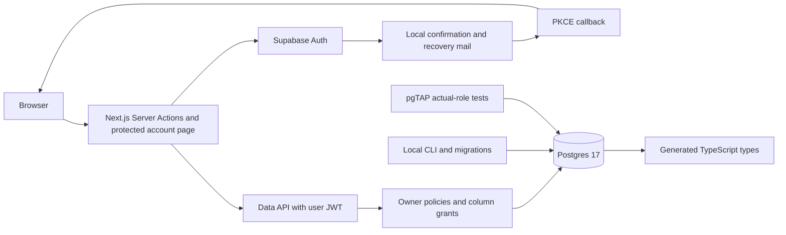

# Architecture

## Auth and ownership

The landing page remains static. Auth screens and the account page render dynamically. Server Actions handle validated credentials; request-scoped SSR clients persist cookie sessions. Proxy verifies claims, refreshes cookies and prevents shared caching. The account page independently verifies the current user with Auth before querying its story count. No privileged credential is part of the application data path.

RLS derives ownership through `auth.users -> stories -> story_pages/assets`. Stories allow owner CRUD on their editable details; column grants reserve ownership and generated fields for server workflows. Children are readable by the owner, with direct writes denied. Deleting an owned parent cascades relational rows.

Local development uses its own project ID, loopback network and ports. Studio/metadata provide optional local MCP inspection; reduced core mode omits Studio/MCP. CLI/admin migration and test setup is separate from application requests.

## Planned workflow

Phase 3 adds the story dashboard, CRUD UI, private Storage bucket, object policies and controlled uploads. Phase 4 adds generation jobs, validated provider output and an authenticated Edge Function. Phase 5 adds private authorized Broadcast channels and reconnect reconciliation without repeated polling.

Database cascades delete metadata, not Storage bytes. Phase 3 must define object cleanup and partial upload handling. Worker privileges, generation-state transitions and concurrency require explicit Phase 4 decisions. Phase 2 intentionally has no service-role application client, Storage bucket, worker, AI API or Realtime channel.
