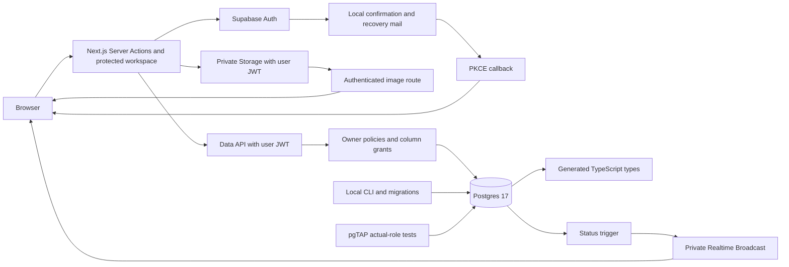

# Architecture

## Auth and ownership

The landing page remains static. Auth screens, account, dashboard, story pages and image responses render dynamically. Server Actions handle validated credentials; request-scoped SSR clients persist cookie sessions. Proxy verifies claims, refreshes cookies and prevents shared caching. Protected pages, mutation actions and the image route independently verify the current user with Auth before accessing data. No privileged credential is part of the application data path.

RLS derives ownership through `auth.users -> stories -> story_pages/assets`. Stories allow owner CRUD on their editable details; column grants reserve ownership and generated fields for server workflows. Pages are readable by the owner, with direct writes denied. Owners can reserve/delete immutable hero-image metadata. Story deletion removes Storage objects before cascading relational rows; a trigger blocks metadata deletion if a committed object still exists.

Local development uses its own project ID, loopback network and ports. Studio/metadata provide optional local MCP inspection; reduced core mode omits Studio, postgres-meta and MCP. CLI/admin migration and test setup is separate from application requests.

## Story and image workflow

`/dashboard` lists owner stories in pages of 20 with stable creation-time/ID ordering. `/stories/new` and `/stories/[id]` share a validated details form. Status stays server-managed. Existing generated pages render as escaped plain text; Phase 3 does not generate new pages.

Server Actions accept bounded input, obtain a verified user and pass that user's JWT to PostgREST/Storage. Image uploads are checked before database reservation: format, decoded pixels, dimensions, size and metadata. A reservation is inserted first, then bytes go to its random immutable owner/story path. One partial unique index allows one hero per story. The private image route repeats ownership and byte validation before returning WebP with `no-store` and `nosniff`; it bypasses Next's shared image optimizer.

Storage and Postgres are separate services. Upload failure retains a removable reservation. Removal calls the Storage API first; failure retains the rows. The guard inspects committed Storage metadata, including during parent cascades. This is retryable cleanup, not a distributed transaction; concurrent/ambiguous uploads still require the production reconciliation design in SECURITY.md. No custom columns, foreign keys or triggers are added to Supabase's managed Storage tables.

## Phase 4 generation flow

A Server Action authenticates the user and calls the owner enqueue RPC before invoking `generate-story`. The Edge Function independently verifies the JWT, loads the story under caller RLS and idempotently reuses/enqueues the job. It adds its private worker header only to lifecycle RPC requests on the same user-scoped client, claims the job, re-reads frozen input, generates/validates five pages and invokes atomic completion. The browser receives refreshed owner data through the action and Phase 5 private Broadcast notifications.

The worker capability is not a Supabase service-role credential. It unlocks only narrow lifecycle SQL paths, each still requiring the story owner's authenticated identity. Elevated code lives in the unexposed private schema. Local provisioning persists only the secret hash in Postgres and keeps the raw secret in the Edge environment. No Next.js process or browser needs it.

Provider selection is deployment configuration. Mock is deterministic and has no network access. The optional Gemini adapter uses a fixed endpoint and explicit model, sends only story text fields, bounds time/bytes and validates output. Provider text is always data. A two-minute lease and three-attempt cap make interrupted work recoverable without automatic expensive retries. There is no durable background consumer, periodic polling or hosted deployment.

## Phase 5 private live updates

An invoker trigger on job INSERT and actual status changes calls `realtime.send` with `private=true`, event `generation_status` and topic `story:<uuid>`. Payloads contain only story/job identifiers, status and the message ID added by Realtime. Job/notification writes share the transaction. No job content, prompts, errors or pages enter Broadcast. The managed helper is best-effort and may warn instead of failing generation if notification insertion fails; the database remains authoritative.

The managed `realtime.messages` SELECT policy permits authenticated Broadcast reception only for an owned parent, exact canonical topic and matching row topic. No client INSERT/Presence policy exists. The policy does not filter the stored private flag because the managed authorization probe inserts only topic/extension; both the producer and channel explicitly select private transport. The policy uses the story primary-key and owner indexes; topic parsing rejects malformed identifiers without raising casting errors. Application tables are not added to a Postgres Changes publication.

The cookie-compatible browser client sends the user's current JWT before subscribing. Each valid event and each successful join/rejoin schedules a coalesced Server Component refresh. That refresh verifies the user and queries under RLS, preventing stale/out-of-order notifications from becoming display authority. Online/visibility events recheck the local session and recover current state without an interval. The SDK handles socket reconnects; route teardown/offline/session changes remove channels and cancel scheduled work. Sign-out uses browser Auth to notify other tabs, then a fixed full navigation clears cached private content. The existing Server Action remains a no-JavaScript fallback.

Authorization is checked on join/token refresh and cached by Realtime, not re-evaluated for each message. Story ownership is immutable here; deletion prevents subsequent generation and denies new joins. Revocation/transfer in a future product must account for that cache and JWT expiry. A public channel with the same name cannot receive private events. Hosted deployment should also disable public channel access globally.
