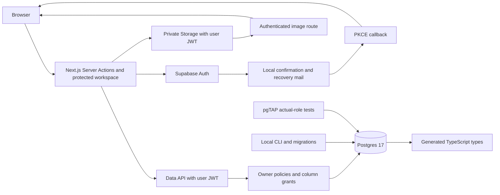

# Architecture

## Auth and ownership

The landing page remains static. Auth screens, account, dashboard, story pages and image responses render dynamically. Server Actions handle validated credentials; request-scoped SSR clients persist cookie sessions. Proxy verifies claims, refreshes cookies and prevents shared caching. Protected pages, mutation actions and the image route independently verify the current user with Auth before accessing data. No privileged credential is part of the application data path.

RLS derives ownership through `auth.users -> stories -> story_pages/assets`. Stories allow owner CRUD on their editable details; column grants reserve ownership and generated fields for server workflows. Pages are readable by the owner, with direct writes denied. Owners can reserve/delete immutable hero-image metadata. Story deletion removes Storage objects before cascading relational rows; a trigger blocks metadata deletion if a committed object still exists.

Local development uses its own project ID, loopback network and ports. Studio/metadata provide optional local MCP inspection; reduced core mode omits Studio, postgres-meta and MCP. CLI/admin migration and test setup is separate from application requests.

## Story and image workflow

`/dashboard` lists owner stories in pages of 20 with stable creation-time/ID ordering. `/stories/new` and `/stories/[id]` share a validated details form. Status stays server-managed. Existing generated pages render as escaped plain text; Phase 3 does not generate new pages.

Server Actions accept bounded input, obtain a verified user and pass that user's JWT to PostgREST/Storage. Image uploads are checked before database reservation: format, decoded pixels, dimensions, size and metadata. A reservation is inserted first, then bytes go to its random immutable owner/story path. One partial unique index allows one hero per story. The private image route repeats ownership and byte validation before returning WebP with `no-store` and `nosniff`; it bypasses Next's shared image optimizer.

Storage and Postgres are separate services. Upload failure retains a removable reservation. Removal calls the Storage API first; failure retains the rows. The guard inspects committed Storage metadata, including during parent cascades. This is retryable cleanup, not a distributed transaction; concurrent/ambiguous uploads still require the production reconciliation design in SECURITY.md. No custom columns, foreign keys or triggers are added to Supabase's managed Storage tables.

## Planned workflow

Phase 4 adds generation jobs, validated provider output and an authenticated Edge Function. Phase 5 adds private authorized Broadcast channels and reconnect reconciliation without repeated polling. Worker privileges, lifecycle transitions and concurrent editing require explicit Phase 4 decisions. No privileged application client, AI API or Realtime channel is introduced in Phase 3.
