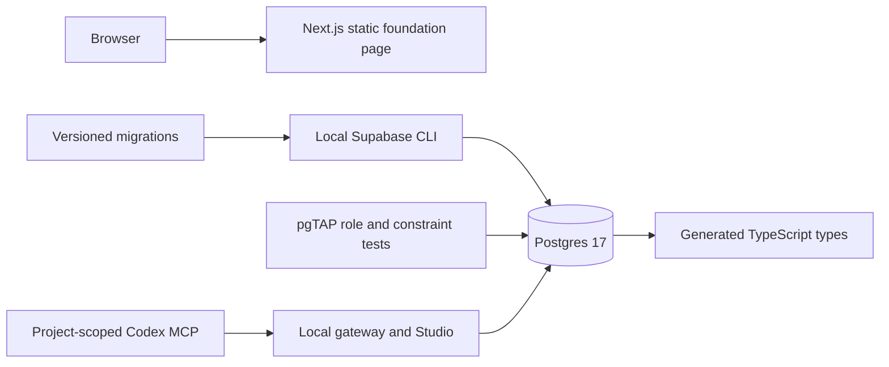

# Architecture

## Implemented foundation

Phase 1 has no browser data path. The local Supabase Auth service runs but application sign-in is not implemented. The three application tables enable RLS and deny all client operations. Privileged migration/test setup is separate from simulated client requests.

## Planned workflow

Phase 2 adds Auth and operation-specific owner policies. Phase 3 adapts story management and introduces a private Storage bucket, object policies, and controlled uploads. Phase 4 adds generation jobs, a mock provider, validated output, and an authenticated Edge Function. Phase 5 adds private authorized Broadcast channels and reconnect reconciliation without repeated polling.

The browser never receives a privileged database credential. Ownership derives from `auth.users -> stories -> story_pages/assets`. Generation lifecycle updates and any elevated worker operations require a separate security decision before implementation.

Database cascades delete relational metadata, not Storage bytes. Phase 3 must explicitly handle object cleanup and partial upload failures.
