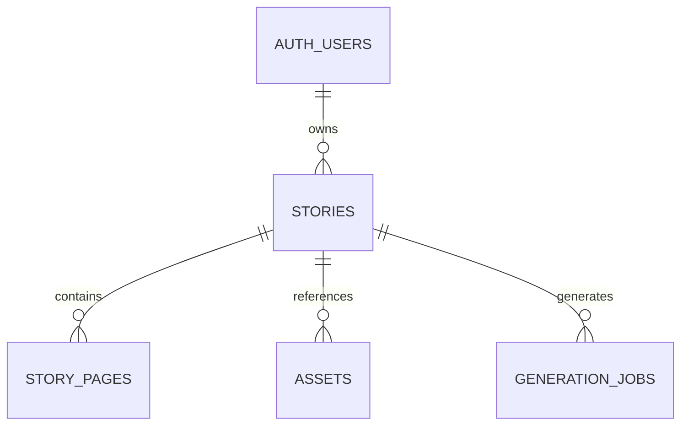

# Database foundation

All IDs are UUIDs generated by Postgres, except deterministic synthetic seed IDs. Timestamps use `timestamptz`. All ownership and parent references are required and cascade on parent deletion.

| Table | Important columns and rules |
| --- | --- |
| `stories` | `owner_id` references Auth; title ≤120, fictional hero name ≤80, prompt ≤2000 characters; required nonblank text; status defaults to `draft`; timestamp trigger updates `updated_at` |
| `story_pages` | Required parent, positive page number, nonblank content ≤8000 characters; unique story/page position |
| `generation_jobs` | Owner-readable job history; one active job per story; protected lifecycle and bounded retries |
| `assets` | Required parent, kind in hero/reference/generated; PNG/JPEG/WebP MIME types; unique relative object path with matching story segment |

`stories.status` allows draft, queued, generating, complete, failed. The enum-like CHECK constrains values; Phase 2 denies client writes to status. Phase 4's lifecycle functions enforce transitions and job/story consistency. Asset path format is a data constraint. Metadata reads and writes check parent ownership; insert policies also bind the first path segment to the authenticated user. There is no foreign key into Storage's managed object table.

Indexes are the primary keys, `(owner_id, created_at desc, id desc)` for dashboard retrieval, unique `(story_id,page_number)` for pages, `assets(story_id)` for parent lookup/cascades, unique asset path, and a partial unique hero-per-story index. The composite page key already covers its parent FK.

Migration order is `create_story_core`, `create_asset_metadata`, `add_owner_authorization`, `add_private_story_storage`, `add_generation_lifecycle`, then `add_private_generation_broadcast`. The sixth migration adds a private invoker trigger and a managed Realtime receive policy; public table/function shapes remain unchanged. The CLI generated the migration timestamps. The seed inserts Alice and Bob database identities, three stories, and three pages; assets are empty. Fixture identities are not login accounts.

The Phase 5 trigger calls `realtime.send` only on job creation or status changes, with an explicit private flag and minimal identifiers/status. It shares the lifecycle transaction, while Realtime delivers asynchronously. The SELECT policy on managed `realtime.messages` checks authenticated owner, canonical `story:<uuid>` topic, row topic and Broadcast extension. Malformed topic parsing yields NULL. No send/Presence policy is present. The managed authorization probe has private=false by default, so that column must not filter receive authorization; producer/channel privacy flags control delivery separately. Realtime owns the message table/grants/RLS; application migrations do not alter that managed structure. Public tables are not published through Postgres Changes. `realtime.test.sql` tests the actual-role boundary, message shape, no-op suppression and rollback behavior.

Use `npm run db:reset` to reconstruct and `npm run db:types` to generate `types/database.ts` from the resulting local `public` schema. The CLI's unformatted output is syntax-checked and formatted with the pinned TypeScript printer; the schema types are never hand-maintained. `db:types:check` applies the same formatting and compares fresh output without overwriting the committed file. Type generation failures preserve the previous file.

`generation_jobs` and its controlled lifecycle are added in Phase 4, described below. The private `story-assets` bucket and its policies are migration-managed. No SQL changes have been applied to a hosted or commercial database.

## Phase 2 authorization

Owners can read/delete their stories, insert title/child_name/prompt with database-generated ownership and status, and update those three editable fields. Story IDs, owner IDs, status and timestamps are not writable by authenticated clients. Both USING and WITH CHECK enforce owner identity on updates. Pages allow parent-owner reads only. Phase 3 extends asset access as described below. Phase 4 adds narrow lifecycle RPC wrappers, described below.

`authorization.test.sql` replaces the Phase 1 all-denied baseline. It runs real API roles with Alice, Bob, absent identity and anonymous claims, checks allowed operations and forbidden column writes, and separately widens grants inside the rolled-back transaction to isolate policy behavior. Foreign-key cascades are tested through authorized parent deletion. Worker writes use the fifth migration’s narrow lifecycle functions, not broad table grants.

## Phase 3 Storage authorization

The fourth migration adds a private bucket (2 MiB; PNG/JPEG/WebP), two asset policies and three Storage policies. Authenticated clients may INSERT only story_id, kind, storage_path and mime_type; kind must be hero, the namespace must match auth.uid(), and the story must be owned. Asset IDs/timestamps are database-generated; updates are denied. The existing assets SELECT policy remains parent-derived. Clients may delete only owned metadata.

Storage SELECT/INSERT/DELETE require the private bucket, the current user's first folder and an RLS-visible matching reservation. There is no UPDATE policy: upsert/move is denied. No anonymous policy is added. All actual object creation/deletion uses the Storage API.

`private.guard_asset_object_delete()` is a trigger-only SECURITY DEFINER function. It has an empty search_path, fully qualified names, no dynamic SQL and no PUBLIC/anon/authenticated EXECUTE grant. It only tests whether a committed object exists at the old path, then rejects deletion with 23503. Definer visibility is needed because cascading story deletion makes the parent invisible to an invoker's RLS. It neither writes Storage tables nor deletes bytes. It does not lock or coordinate a Storage upload that has passed preflight but has not committed; production reconciliation remains required.

`storage.test.sql` adds rolled-back policy/guard fixtures. Browser integration tests use real Storage byte APIs and user sessions. Public table shapes remain unchanged, so generated TypeScript is compared rather than manually edited.

## Phase 4 jobs and controlled writes

`generation_jobs` holds `story_id`, fixed `job_type=story`, queued/generating/complete/failed status, nullable mock/Gemini provider, allowlisted safe error metadata, timestamps and a two-minute `lease_expires_at`. A `(story_id,created_at DESC,id DESC)` index serves owner history and the FK; a partial unique index admits one active job per story. Lifecycle CHECK constraints require coherent terminal/error timestamps. Owner SELECT follows the parent story; all direct client mutations are denied.

`enqueue_generation(story_id)` serializes on the owned story, returns an existing active job, marks expired work interrupted, and allows at most three attempts. Completed stories cannot regenerate. `claim_generation(job_id,provider)` changes an owned unexpired queued job once. `finish_generation(job_id,pages,error_code)` validates and atomically publishes five sequential pages or records an allowlisted failure. Claim/finish require both owner identity and the Edge worker capability. Public wrappers are invokers; private helpers have reviewed definer elevation, empty search paths and explicit grants. See ADR-014 for the private capability table and local provisioning.

Direct status/page/job writes remain prohibited. Input changes are rejected while queued/generating and after completion; failed inputs may be edited. Deleting a story cascades its jobs and pages. A deleted, completed or expired job cannot accept a late result. This transaction boundary covers Postgres writes, not provider delivery or Storage operations.

## Phase 6 measurement

`npm run db:performance` runs a fixed local-only workload with 10,000 fictional stories and related rows, normal planner settings and the actual authenticated RLS role, then verifies fixture rollback. [Full results and limits](PERFORMANCE.md) show selective queries using existing indexes, with deep offset pagination doing more scan/sort work than the cursor comparison. No schema, policy, index or generated-type change was warranted. A temporary invoker-only EXPLAIN helper exists only inside the rolled-back measurement transaction.

The original Phase 6 measurement used PostgreSQL 17.6. The supported local runtime is now PostgreSQL 17.11 via CLI 2.119.0; updated evidence is recorded in [LOCAL-HARDENING.md](LOCAL-HARDENING.md).

## Migration handoff and recovery

Phase 7 adds no migration or schema change. A future deployment must review and apply this ordered inventory to a new, explicitly selected reference database:

| Migration | Purpose |
| --- | --- |
| [20260927034957](../supabase/migrations/20260927034957_create_story_core.sql) | Stories/pages, constraints, indexes and deny-by-default access |
| [20260927034959](../supabase/migrations/20260927034959_create_asset_metadata.sql) | Private asset metadata foundation |
| [20260928202944](../supabase/migrations/20260928202944_add_owner_authorization.sql) | Owner RLS and restricted column grants |
| [20260929041425](../supabase/migrations/20260929041425_add_private_story_storage.sql) | Private bucket, reservation policies and deletion guard |
| [20260929231039](../supabase/migrations/20260929231039_add_generation_lifecycle.sql) | Jobs, leases, caller/capability lifecycle and private worker-key table |
| [20260930142245](../supabase/migrations/20260930142245_add_private_generation_broadcast.sql) | Minimal private status messages and owner receive policy |

Keep applied migrations immutable; author later changes through the CLI and review grants/RLS with each exposed change. Compare remote migration history and a dry run before applying anything. Do not send the local seed, browser fixtures, reset operation or synthetic performance workload to a hosted database. Generated types must reflect the reviewed migrations, not an unrelated project's schema.

The worker-key table intentionally has no client policy. Migrations create its structure; a separately authorized operator provisions the environment-specific SHA-256 hash. The raw capability belongs only in the Edge secret store. The local setup/rotation tools and protected hosted material preparation are described in [OPERATIONS.md](OPERATIONS.md); applying and verifying that material on hosted resources remains a separate release operation.

Database rollback and object-byte recovery are separate concerns. SQL cascades cannot remove or restore Storage bytes; use Storage APIs and a tested object backup process. Follow the [deployment recovery plan](DEPLOYMENT.md#rollback-recovery-and-incident-response), preserve backward compatibility where possible, and never use a reset as hosted rollback.

## Local hardening migration

The seventh CLI-created migration, [20261006133227_add_resource_admission_and_reconciliation.sql](../supabase/migrations/20261006133227_add_resource_admission_and_reconciliation.sql), adds private controls, fixed-window counters, independent image/provider leases and immutable path retirement. It installs trigger admission and two owner-scoped invoker image RPCs, preserving explicit grants and all existing owner RLS. Fresh migrations leave admission disabled. Only the disposable local seed enables it automatically; hosted operators must review/enable explicitly.

The generated public types include `admit_image_processing` and `release_image_processing`. Private operators never write managed Storage object metadata. [Resource tests](../supabase/tests/database/resources.test.sql) cover quotas, pauses, direct authorization and path retirement; `npm run db:concurrency` checks four simultaneous authenticated transactions at an account boundary. See [OPERATIONS.md](OPERATIONS.md) for maintenance and deployment limits.
