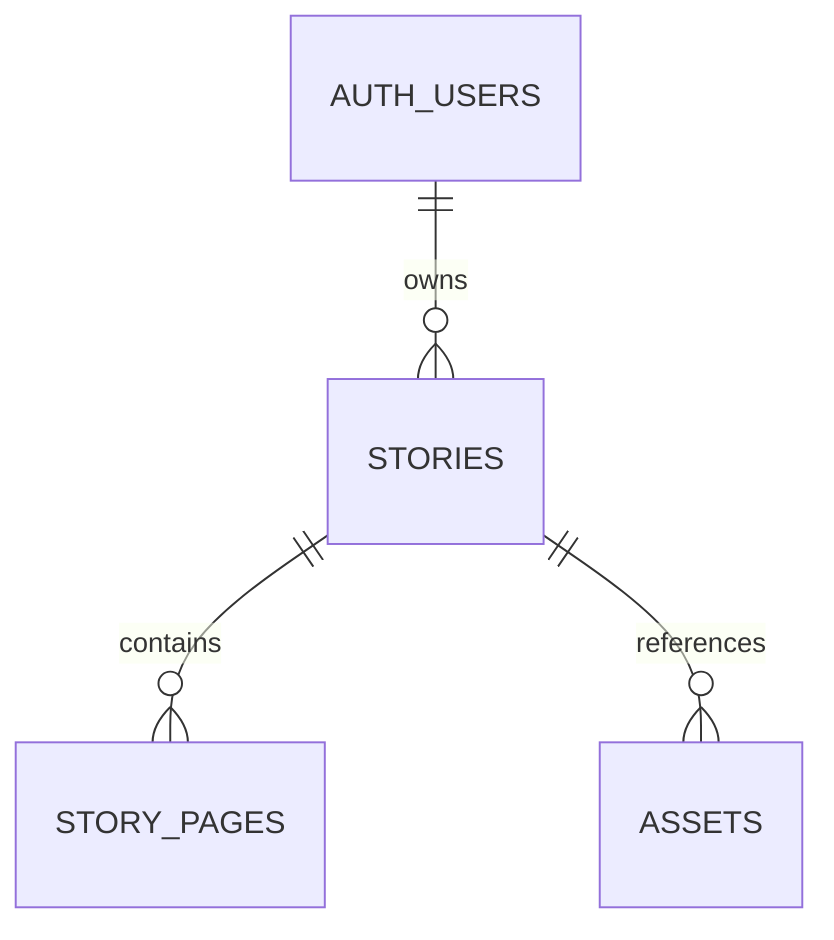

# Database foundation

All IDs are UUIDs generated by Postgres, except deterministic synthetic seed IDs. Timestamps use `timestamptz`. All ownership and parent references are required and cascade on parent deletion.

| Table | Important columns and rules |
| --- | --- |
| `stories` | `owner_id` references Auth; title ≤120, fictional hero name ≤80, prompt ≤2000 characters; required nonblank text; status defaults to `draft`; timestamp trigger updates `updated_at` |
| `story_pages` | Required parent, positive page number, nonblank content ≤8000 characters; unique story/page position |
| `assets` | Required parent, kind in hero/reference/generated; PNG/JPEG/WebP MIME types; unique relative object path with matching story segment |

`stories.status` allows draft, queued, generating, complete, failed. The enum-like CHECK constrains values; Phase 2 denies client writes to status. Transition enforcement and job/story consistency belong to Phase 4. Asset path format is a data constraint. Metadata reads now check parent ownership; Phase 3 must add write-path owner checks and Storage RLS together. There is no foreign key into Storage's managed object table.

Indexes are the primary keys, `(owner_id, created_at desc, id desc)` for dashboard retrieval, unique `(story_id,page_number)` for pages, `assets(story_id)` for parent lookup/cascades, and unique asset path. The composite page key already covers its parent FK.

Migration order is `create_story_core`, `create_asset_metadata`, then `add_owner_authorization`. The third migration adds six operation-specific owner policies and explicit column grants; table/column shapes are unchanged, so generated types do not change. The CLI generated their timestamps. The seed inserts Alice and Bob database identities, three stories, and three pages; assets are empty. Fixture identities are not login accounts.

Use `npm run db:reset` to reconstruct and `npm run db:types` to generate `types/database.ts` from the resulting local `public` schema. The CLI's unformatted output is syntax-checked and formatted with the pinned TypeScript printer; the schema types are never hand-maintained. `db:types:check` applies the same formatting and compares fresh output without overwriting the committed file. Type generation failures preserve the previous file.

`generation_jobs` is intentionally deferred to Phase 4. Storage bucket/policies are deferred to Phase 3. No SQL changes have been applied to a hosted or commercial database.

## Phase 2 authorization

Owners can read/delete their stories, insert title/child_name/prompt with database-generated ownership and status, and update those three editable fields. Story IDs, owner IDs, status and timestamps are not writable by authenticated clients. Both USING and WITH CHECK enforce owner identity on updates. Pages and assets allow parent-owner reads only. No child writes or privileged RPCs are exposed.

`authorization.test.sql` replaces the Phase 1 all-denied baseline. It runs real API roles with Alice, Bob, absent identity and anonymous claims, checks allowed operations and forbidden column writes, and separately widens grants inside the rolled-back transaction to isolate policy behavior. Foreign-key cascades are tested through authorized parent deletion. Worker writes and Storage writes need later migrations, not broad grants added to work around RLS.
