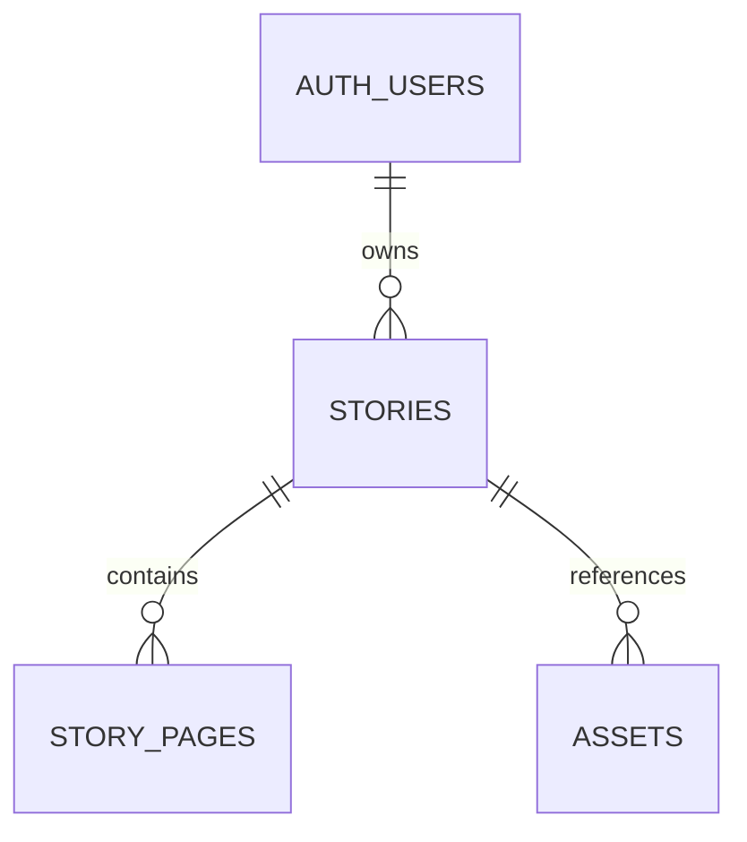

# Database foundation

All IDs are UUIDs generated by Postgres, except deterministic synthetic seed IDs. Timestamps use `timestamptz`. All ownership and parent references are required and cascade on parent deletion.

| Table | Important columns and rules |
| --- | --- |
| `stories` | `owner_id` references Auth; title ≤120, fictional hero name ≤80, prompt ≤2000 characters; required nonblank text; status defaults to `draft`; timestamp trigger updates `updated_at` |
| `story_pages` | Required parent, positive page number, nonblank content ≤8000 characters; unique story/page position |
| `assets` | Required parent, kind in hero/reference/generated; PNG/JPEG/WebP MIME types; unique relative object path with matching story segment |

`stories.status` allows draft, queued, generating, complete, failed. The enum-like CHECK constrains values; Phase 2 denies client writes to status. Transition enforcement and job/story consistency belong to Phase 4. Asset path format is a data constraint. Metadata reads and writes check parent ownership; insert policies also bind the first path segment to the authenticated user. There is no foreign key into Storage's managed object table.

Indexes are the primary keys, `(owner_id, created_at desc, id desc)` for dashboard retrieval, unique `(story_id,page_number)` for pages, `assets(story_id)` for parent lookup/cascades, unique asset path, and a partial unique hero-per-story index. The composite page key already covers its parent FK.

Migration order is `create_story_core`, `create_asset_metadata`, `add_owner_authorization`, then `add_private_story_storage`. The third migration adds six operation-specific owner policies and explicit column grants; table/column shapes are unchanged, so generated types do not change. The CLI generated their timestamps. The seed inserts Alice and Bob database identities, three stories, and three pages; assets are empty. Fixture identities are not login accounts.

Use `npm run db:reset` to reconstruct and `npm run db:types` to generate `types/database.ts` from the resulting local `public` schema. The CLI's unformatted output is syntax-checked and formatted with the pinned TypeScript printer; the schema types are never hand-maintained. `db:types:check` applies the same formatting and compares fresh output without overwriting the committed file. Type generation failures preserve the previous file.

`generation_jobs` is intentionally deferred to Phase 4. The private `story-assets` bucket and its policies are migration-managed. No SQL changes have been applied to a hosted or commercial database.

## Phase 2 authorization

Owners can read/delete their stories, insert title/child_name/prompt with database-generated ownership and status, and update those three editable fields. Story IDs, owner IDs, status and timestamps are not writable by authenticated clients. Both USING and WITH CHECK enforce owner identity on updates. Pages allow parent-owner reads only. Phase 3 extends asset access as described below. No privileged RPC is exposed.

`authorization.test.sql` replaces the Phase 1 all-denied baseline. It runs real API roles with Alice, Bob, absent identity and anonymous claims, checks allowed operations and forbidden column writes, and separately widens grants inside the rolled-back transaction to isolate policy behavior. Foreign-key cascades are tested through authorized parent deletion. Worker writes need their own later migration, not broad grants added to work around RLS.

## Phase 3 Storage authorization

The fourth migration adds a private bucket (2 MiB; PNG/JPEG/WebP), two asset policies and three Storage policies. Authenticated clients may INSERT only story_id, kind, storage_path and mime_type; kind must be hero, the namespace must match auth.uid(), and the story must be owned. Asset IDs/timestamps are database-generated; updates are denied. The existing assets SELECT policy remains parent-derived. Clients may delete only owned metadata.

Storage SELECT/INSERT/DELETE require the private bucket, the current user's first folder and an RLS-visible matching reservation. There is no UPDATE policy: upsert/move is denied. No anonymous policy is added. All actual object creation/deletion uses the Storage API.

`private.guard_asset_object_delete()` is a trigger-only SECURITY DEFINER function. It has an empty search_path, fully qualified names, no dynamic SQL and no PUBLIC/anon/authenticated EXECUTE grant. It only tests whether a committed object exists at the old path, then rejects deletion with 23503. Definer visibility is needed because cascading story deletion makes the parent invisible to an invoker's RLS. It neither writes Storage tables nor deletes bytes. It does not lock or coordinate a Storage upload that has passed preflight but has not committed; production reconciliation remains required.

`storage.test.sql` adds rolled-back policy/guard fixtures. Browser integration tests use real Storage byte APIs and user sessions. Public table shapes remain unchanged, so generated TypeScript is compared rather than manually edited.
